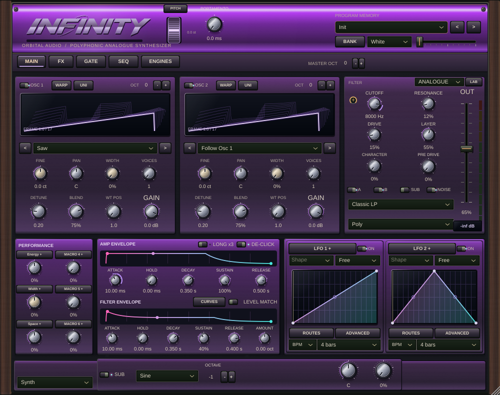
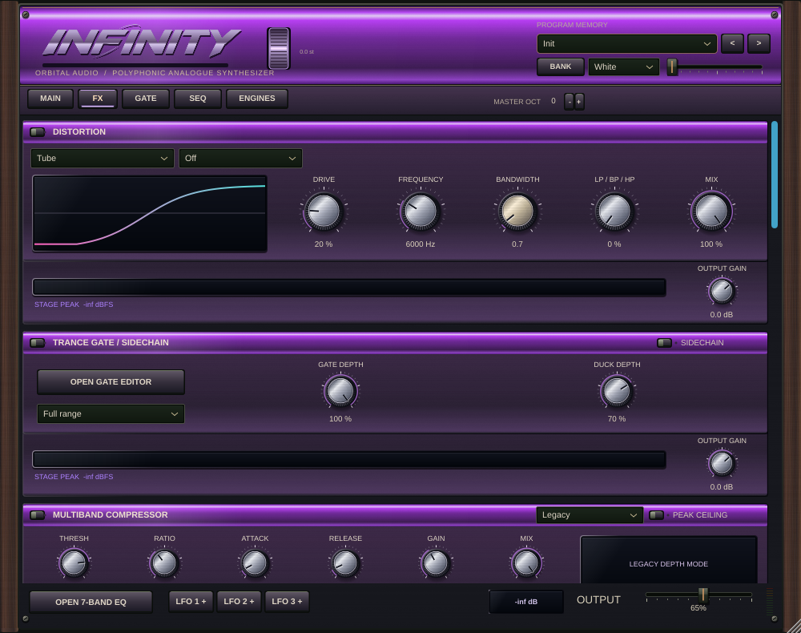

# SPACE INFINITY 0.6.0 — sound and workflow update

A new distortion rack, revised acid/lead/pad/choir voicings, editable preset details and hybrid creation join the control and level improvements in this build.

## Distortion

Open FX and enable DISTORTION. Choose a character, set Drive, select filter Off/Pre/Post, then adjust Frequency, Bandwidth, LP/BP/HP and Mix. Each module has its own output trim and peak/clip indication. The minimum output setting mutes an enabled stage. Start with a low Mix for bass and resonant acid.

Fourteen independently implemented modes cover saturation, clipping, diode, folding, downsampling, rectification and custom shaping. Drive controls rate reduction in Downsample and the blend between A/B transfer curves in X-Shaper. Drag vertically in the transfer display to change Drive. In X-Shaper, drag the curve points; Shift edits curve B. These controls follow the documented Serum 2 workflow; the DSP is our implementation, and is not claimed to be an identical proprietary model.

## Presets and your edits

The bank remains 160 sounds plus Init, with the requested category counts. Bass and acid presets follow your MIDI; they do not generate patterns. Acid sounds use different resonant contours, oscillator shapes and dedicated distortion characters. Airy pads have wider, brighter layers with slow timbral motion. Choirs now use three recorded vowel ensembles with low/middle/high pitch zones rather than stretching one voice across octaves. Original voices are measured and tuned before layering. Leads retain fast attacks while separating mono, FM, sync, fifth and supersaw roles.

In Presets, edit NAME, CREATOR and comma-separated TAGS. SAVE DETAILS changes those details without changing the sound. Use the tag menu or search names, creators and tags. SAVE NEW stores a separate sound; SAVE AS exports a portable .sipreset to your chosen folder.

REPLACE saves the current sound over a selected musical factory or user slot locally; previous edited versions go into Backups. Init remains the reset sound. EXPORT EDITS ZIP collects local factory replacements and metadata so they can be incorporated into a later shipped bank. Upload that ZIP when your refinements are ready. RESTORE FACTORY returns the local list to the shipped bank while retaining user files and backups.

To make a hybrid, select a preset and press PARENT A, select another and press PARENT B, choose the blend and press HYBRIDISE. Preview, then SAVE NEW. Sample/wavetable assets stay with A; continuous filter, envelope and FX settings blend, and discrete choices switch at the midpoint. Patterns/gates/pump start off and the hybrid starts conservatively trimmed. The parents remain unchanged. This is a starting point for sound design, not a guarantee every pair will blend musically.

## Main controls and appearance

LEVEL MATCH is optional: enable it while playing the starting pluck, allow about a quarter second to learn its level, then open cutoff. It reduces rising level without boosting quiet tails/noise. Toggle it off/on to learn a new reference. Factory level trims are measured separately; polyphony and playing velocity still affect level.

Analogue/Digital selects whether component variation and colour apply, keeping the existing filter/envelope choices. Energy, Width and Space remain, with assignable Tone, Punch and Character starting macros. Ctrl-drag an LFO display onto a knob (including Sub level and FX), then set the assignment amount. The pitch wheel returns to centre after a pointer gesture and supports ±24 semitones; host automation remains available.

The gate has BLOCKS and CURVE views, classic timed patterns and frequency splitting, separate from the note sequencer. Pink-to-teal displays and the reactive logo meter sit against brighter purple metal, with layered status lights. Duplicate basic controls were removed from ENGINES.

## Research and provenance

- [Xfer Serum 2 User Guide, Using Serum FX](https://www.xferrecords.com/manual/serum-2/docs): distortion Drive, filter position, graph interaction and X-Shaper morph behaviour.
- [Roland TB-303 original manual](https://cdn.roland.com/assets/media/pdf/TB-303_OM.pdf): cutoff, resonance, envelope, decay, accent and slide roles.
- [Roland on slide/accent sequencing](https://articles.roland.com/mastering-the-tb-303-sequencer-in-roland-cloud/).
- [SpectMorph CC0 recordings](https://github.com/swesterfeld/spectmorph-instruments): nine choir derivatives; pinned source hashes, processing and output hashes in CHOIR_SAMPLE_PROVENANCE.json.

Track references describe intended sound roles; these are authored patches, not extracted artist presets or verified identical recreations. Earlier source research remains in TRANCE_FACTORY_BANK_RESEARCH.md. Validation evidence is recorded in the repository audit documents.

For a reproducible sample rebuild, run `scripts/prepare-trance-samples.py` first, then `scripts/prepare-choir-multisamples.py`; the latter appends the choir zones to the base piano/string zone header. For received factory-edit ZIPs, run `scripts/import-factory-edits.py edits.zip`, then `scripts/design-trance-bank.py` and rebuild. Imported stable-key overrides and metadata are included in the compiled bank.
