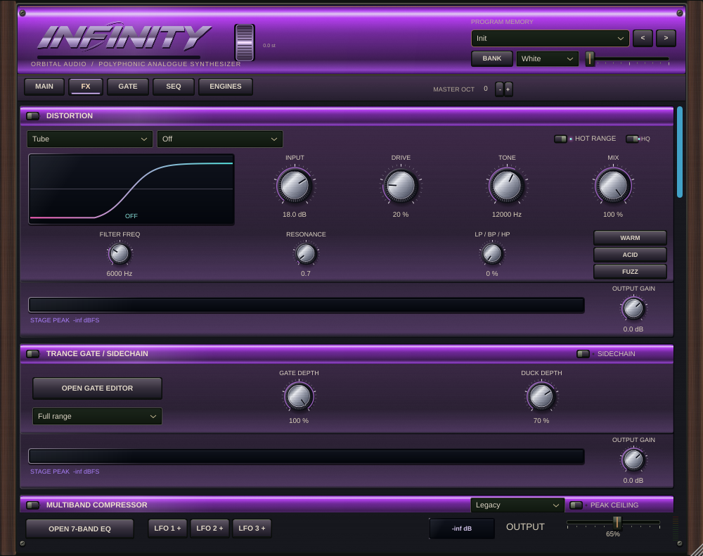

# 0.7.0 distortion drive update

The user reported weak distortion on quieter filtered synth sounds. The
[Lucid Samples guide](https://www.lucidsamples.com/blog/understanding-vst-distortion-plugins-a-comprehensive-guide-for-music-producers)
separates gentle saturation from aggressive distortion/fuzz, and stresses input
drive, wet blend, tone, output control and level-conscious A/B checks. It is a
general production guide, not a circuit specification. The implementation uses
original transfer functions and makes no claim to clone the commercial plugins
mentioned in that article.

**HOT RANGE** adds up to 24 dB of pre-drive across the knob's travel. The main
analogue waveshapers therefore reach 60 dB of Drive, compared with the standard
36 dB range, before the separate Input control. This pushes quiet filtered notes
into nonlinear shaping earlier. The range transition is smoothed. There is no
adaptive gain follower that gradually fades notes.

**Tape**, **Fuzz** and **Bit Crush** extend the existing 17 characters. Tape is an
authored soft-knee saturation character; Fuzz has a much sharper transfer around
zero; Bit Crush reduces amplitude resolution, while Downsample remains the
separate sample-rate reduction character. HQ smooths the analogue wave shapers;
digital crushers deliberately retain their stepped texture. The existing tone,
pre/post filter, custom shapers, mix, output gain and stage meter remain.

**WARM**, **ACID** and **FUZZ** buttons set useful combinations of input, drive,
tone, wet blend, filter and output trim. They are starting points; the module's
Output Gain sets the finished level. They preserve the synth's amp envelope and
master settings. A stronger harmonic change is tested by harmonic-to-fundamental
power, so raising output alone cannot pass the test.

Fresh Init enables HOT RANGE. Existing factory sounds and saved presets keep the
standard response unless HOT is enabled or a character button is pressed. The
original 17 mode indices and parameter IDs are retained. Missing `distHot` in an
older state recalls as off. This also preserves the completed Heritage bank's
calibration except for any explicitly revised HOT presets, which are remeasured.

## Measured validation

On a quiet -40 dBFS peak sine, Drive 55%, Input +12 dB: standard-range THD is
2.50%; HOT is 15.90% (harmonic-to-fundamental power 0.0006264 vs 0.0252677).
The comparison uses a normalized harmonic ratio, independently of output gain.
On the HOT high-frequency probe, HQ reduces the alias-power fraction from
0.09910 to 0.004853, about 95%. All 20 characters are checked at 44.1, 48 and
96 kHz, including dry mix, finite output and sustained-level stability.

A frozen 0.6.3 fixture checks all original 17 modes, pre/post filter positions
and automation: maximum sample difference is zero with HOT off. Missing-field
state recall and module output mute also pass. The complete 20-suite native
regression passes. The module fits at 800 and 1000 pixel widths.

