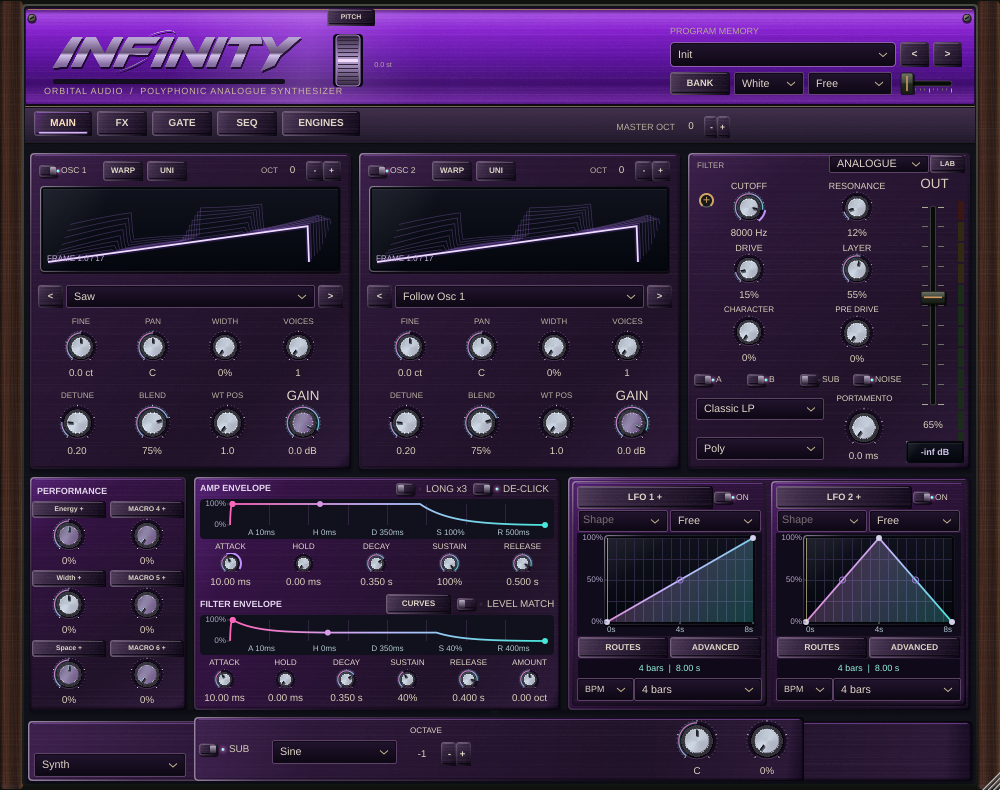
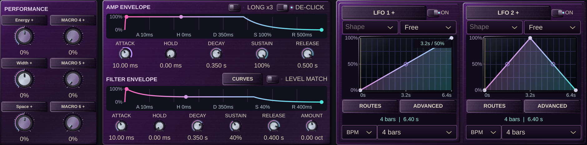

# Numbered LFO and envelope graphs — 18 November 2026

The 0.7.1 cycle-duration footer did not put numbers on the graph itself. This follow-up adds permanent time ticks and percentage scales to both visible LFO graphs and the shared gate curve editor. Compact panes show the start, midpoint and endpoint; wider editors show quarter divisions. The time ruler follows BPM/Hz and triplet/dotted settings. Ping-pong's ruler covers one forward pass; the existing footer covers its full return cycle. Phase offsets and rate modulation do not turn the ruler into an elapsed playback clock.

Hover or drag inside an LFO/gate graph to see position time and percentage in a dark numeric badge. A dragged point reports its snapped location; bending a segment reports curve amount. Plotting and pointer input share the same bounds, so reserving space for the scales does not displace edit targets. Ordinary clicks in the axis margins do not edit the curve.

The amp and filter graphs show 0/100% levels (also 50% in larger views) and a permanent row of actual A/H/D/S/R values within the display. Timing values follow knob edits and LONG x3. Sustain is held until note-off: it is reported as a level, not as a fictitious fixed note length. The expanded contour view explains this explicitly.

Validation uses the native UI bounds/render checks at800/1000/1180/1500 widths plus the existing LFO, envelope/analogue and gate/sequencer interaction suites. All three relevant native suites passed (AnalogueExpansion, DualLFO, RhythmWorkflow), and all four page/size UI renders passed. Additional checks cover cursor time/percentage and envelope values after an actual graph drag and LONG x3. A final focused LFO/UI pass verified the final readout screenshot. Synth DSP, parameter definitions and presets are unchanged.

This is a source/native-preview follow-up. The previously verified Windows installer from commitf8db6e7 predates these graph labels. Downloads remain held; rebuild/package the current source before providing an updated Windows installer.
