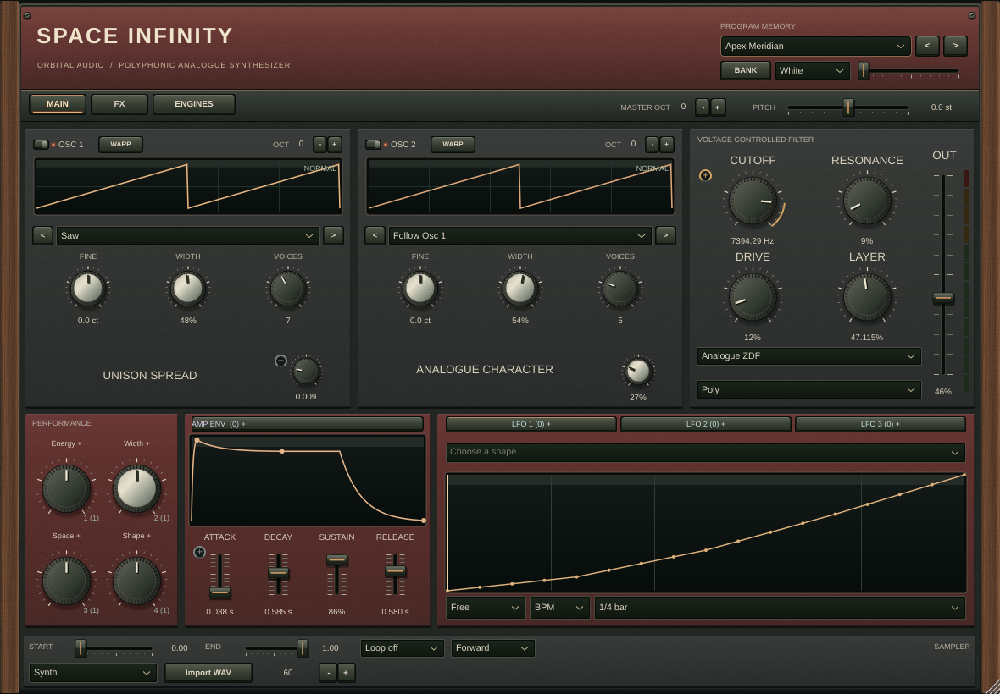

# Hardware interface redesign

## Visual research

Reviewed 11 November 2026:

- [u-he Diva official product page and interface screenshots](https://u-he.com/products/plug-ins/diva/index.html): consistent lighting, readable printed scales, sculpted knobs, distinct material zones and wood end cheeks. SPACE INFINITY uses this hardware vocabulary with its own layout and artwork.
- [Davies Molding 1900-H instrument knob](https://daviesmolding.com/catalog/series/knobs/control/1900-h/): fluted thermoset skirts and a clear physical pointer inspired the new rotary controls.
- [NKK illuminated pushbuttons](https://www.nkkswitches.com/products/illuminated-pushbutton/): sculptured caps, recessed mounting and restrained status illumination informed the switch treatment.
- [ambientCG materials and licence](https://docs.ambientcg.com/license/): CC0 texture source considered for metal and wood surfaces. Photographic PBR maps are not bundled in this implementation; original, deterministic procedural grain keeps the fine surface detail consistent at every editor size.
- [Poly Haven asset FAQ](https://docs.polyhaven.com/en/faq): alternative CC0 material source reviewed.

## Implemented in the native editor

- Oxblood enamel, charcoal metal modules, subtly brushed surface grain, walnut-coloured end cheeks, machined screws and folded chassis rails.
- Fluted rotary skirts, layered contact shadows, fixed-light cap reflections, inset pointer marks, silk-screened scales and satin-metal secondary knobs.
- Fader slots with printed calibration, shaded caps and amber index lines; illuminated slide switches and sculpted mode buttons.
- Recessed programme and waveform displays; coordinated amber/ivory display traces and typography.
- Smaller oscillator displays leave space for physical fine-tune, width and voice-count knobs. Default size is 1180 x 820; the existing 800 x 760 through 1500 x 950 resize range remains available.
- Static chassis, panel and material rendering is cached per editor size/page. Animated traces and controls can repaint without rebuilding the wood, grain, gradients and seams each frame.

Parameters and attachments remain connected to the existing native controls. DSP algorithms, factory patches, saved parameter IDs and preset navigation are unchanged by this visual work. The oscillator display remains a parameter-based waveform preview, not an oscilloscope capture of the audio output.

## Reproducing visual checks

On Windows, build with the existing scripts. Native tests are also available on Linux by configuring with `-DSPACE_INFINITY_BUILD_TESTS=ON` and the JUCE desktop dependencies installed. Run `SpaceInfinitySmoke --ui-only` on a display to write real native Main/FX screenshots at 800, 1000, 1180 and 1500 pixels and check visible controls remain inside the editor.

No u-he, Davies or NKK graphics, logos, skin files or product photographs are included in the plugin. All shipped interface artwork is original JUCE drawing code in `Source/HardwareTheme.h`.

## Validation on 11 November 2026

- Built with JUCE 8.0.7, GCC 14 and CMake Release on Linux; native Standalone and VST3 targets compile. Launched the actual Standalone application on X11.
- Native Main and FX screenshot/bounds checks pass at 800 x 760, 1000 x 790, 1180 x 820 and 1500 x 950.
- ExtendedCore, AnalogueProbe, isolated preset-management/navigation tests and extended native engine smoke tests pass. The last two can also be invoked as `SpaceInfinitySmoke --preset-tests` and `SpaceInfinitySmoke --extended-tests`; they are separate CTest entries so an earlier audition failure does not prevent them from running.
- The full audio audition stops at **Glass Pizzicato**, peak **0.0000525983**, below the existing **0.0001** minimum. The test threshold and patch/DSP source have not been changed by this redesign. This remains a release blocker; the visual checks passing do not establish a release candidate.
- A new Windows CI run is required for this revision. Windows/FL Studio testing was not performed in the Linux environment. CI now retains the audition/screenshots artifact after test failures while the release package remains gated on successful validation.

`hardware-main.png` and `hardware-fx.png` are native component renders from the built editor. `hardware-standalone.png` captures the running Linux application, including its native window frame; it is not a generated design concept.
