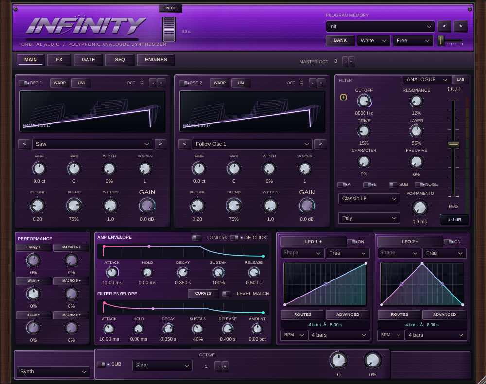
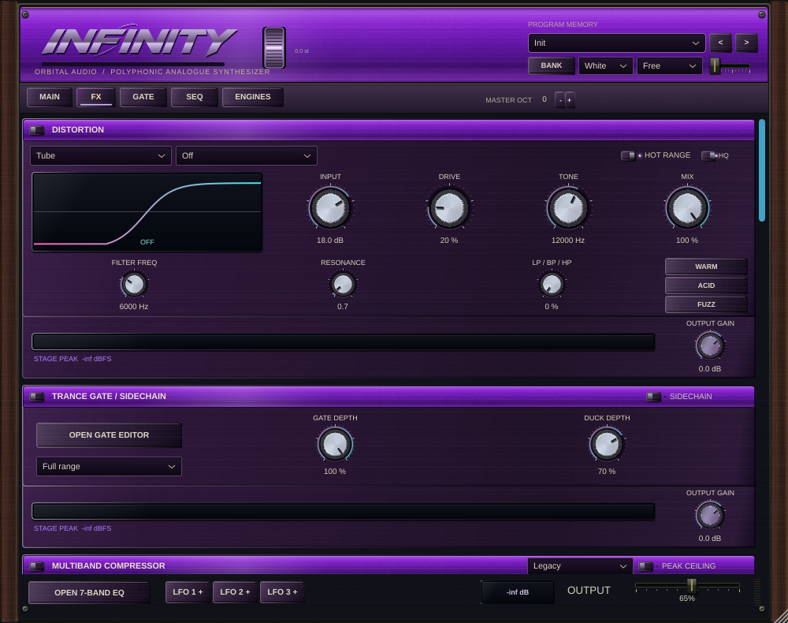

# SPACE INFINITY 0.7.1 — materials, timing and noise modes

The purple finish now uses finer brushed grain, machined panel edges, shaded sockets and original rendered metal knob caps. Knob lighting stays fixed to the panel while the pointer and pink/teal value arc move. Raised buttons have separate face, bevel and shadow. The approved Infinity badge and its output-reactive illumination remain; chassis artwork is cached at the display's pixel density, up to 3×.

## Timing without guesswork

Both MAIN LFO panes display their base cycle in musical time and seconds/milliseconds. For example, four bars at 120 BPM is 8.00 seconds; at 150 BPM it is 6.40 seconds. Triplet, dotted and ping-pong timing are included. Hover the readout for the tempo and explanation. The display follows the host's reported tempo; 120 BPM is the fallback. Bars retain the engine's four-quarter-note definition. With rate modulation, the label describes the base setting rather than instantaneous modulation.

In Hz mode, type a frequency or a duration: `500 ms` gives 2 Hz and `2 s` gives 0.5 Hz. Advanced Delay/Rise accept seconds or milliseconds; Smooth accepts milliseconds or an explicitly suffixed seconds value. Envelope knobs retain their existing fine timing and Shift-drag behaviour.

FX rates below 1 Hz now retain decimals rather than rounding to zero. Chorus/flanger/phaser rates also accept cycle durations. FX frequency fields understand `kHz`, and time fields convert explicitly entered `s`/`ms` to their parameter's units. No extra controls or pages are needed.

## White / Dark / Bright noise playback

The header has a dedicated playback menu beside noise colour:

- **Free:** a separate noise stream continues through idle gaps. The amp envelope still shapes the sound when a note plays.
- **Retrigger:** each new note restarts the same noise sequence and colour-filter memory, giving repeatable attacks. Other oscillators, envelopes, filters and effects can still vary the resulting sound.
- **Random:** preserves the previous per-note noise behaviour.

New Init patches use Free. Existing factory sounds and saved presets that omit the new field use Random. The new parameter is appended after the existing parameter list, retaining earlier parameter indices. Noise mode saves with a preset/project.

## Validation

Native audio tests cover White/Dark/Bright repeatability, Free advancing during silence, saved recall and omitted-field compatibility. Timing checks cover BPM, Hz, dotted/triplet/ping-pong durations, actual attached slider parsers and visible readouts at all four supported window sizes. All21 native suites passed on Linux (229.84s) and Windows (274.16s), along with the Python preset importer, Windows install/uninstall and installer ZIP verification. Native screenshots above are generated from the compiled editor, not concept artwork. FL Studio listening remains the owner's separate test.

The original 160 factory presets and the separate Heritage 200 bank are retained. No preset-volume, distortion or analogue-filter redesign is part of this update. Artwork is original procedural material rendering; generation source and hashes are in `scripts/artwork/render-hardware.py` and `native-vst3/Assets/Hardware/PROVENANCE.json`.
