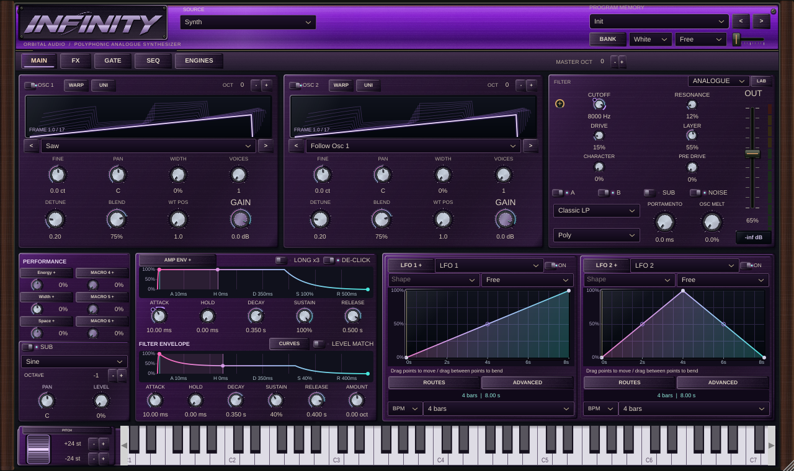
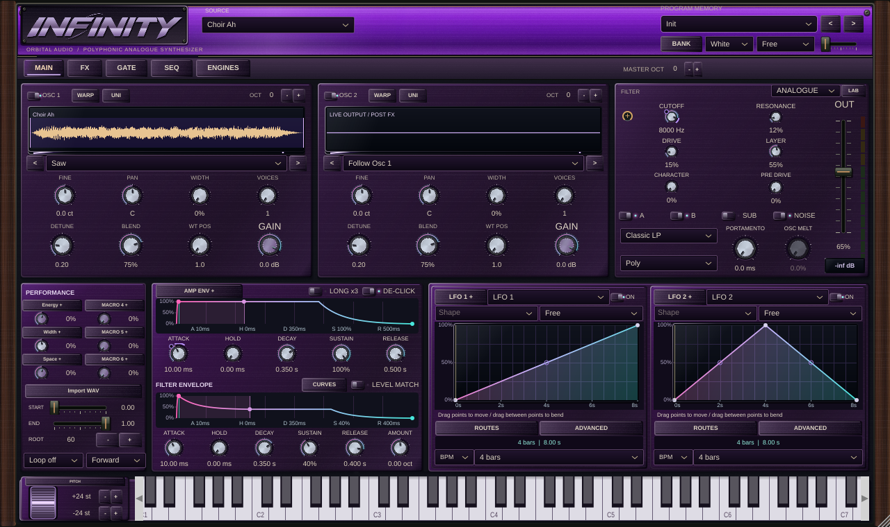
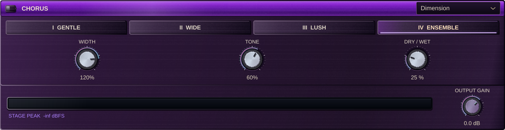

# SPACE INFINITY 0.7.2 — main layout, modulation and sound controls

## Main-page layout

The default window is 1280 × 760, with a shorter overall layout and wider LFO plots to avoid the tall, narrow proportions of the first preview. Interactive resizing starts at 1000 × 760; defensive rendering is also checked at 800 pixels. The compact header leaves room for a horizontal oscillator/filter row. Both numbered amp/filter envelope plots and two numbered LFO editors stay visible below. Performance and assignable macros occupy the left column, with the sub underneath. A playable piano keyboard spans the bottom; its notes feed the native synth alongside host MIDI. The keyboard appears for both synth and sampler sources. Sampler import, trim, root, looping and reverse controls occupy the lower-left auxiliary panel when a sample source is selected.

The visual arrangement follows the owner's Serum 2 reference while retaining the purple metal panels, analogue controls and approved Infinity lettering. The recessed logo plate has an inner shadow, a machined edge and small fasteners. Its light responds to final output.

## Pitch wheel

The larger ribbed wheel sits bottom-left beside the sub, with a 36 × 46-pixel visible drum and a larger drag area. Separate **+24 st / −24 st** fields set the upward and downward stops independently, from zero to 24 semitones each. The wheel stays visually centred at zero even with unequal stops, and springs back to zero on release. Host automation and MIDI bend respect those stops. Changing a stop also rescales a held physical MIDI wheel immediately; the existing MIDI bend range remains an additional cap. The chosen stops are saved with the patch.

## Direct modulation editing

Drag LFO1/2/3 or **AMP ENV +** onto a numeric synth/FX control. Assignment selects that source and leaves the destination’s base value intact. Drag the small upper-left halo or outer range ring; alternatively Alt-drag the main knob. Shift gives fine amount movement. Negative values invert the influence. Shift+Alt-click switches unidirectional/bidirectional movement. Right-click offers numeric amount, invert, polarity and removal.

When multiple sources affect the same control, selecting a source chooses its corresponding ring/amount. The range arc uses the destination’s actual parameter scaling. Existing routes remain; new amp support adds16 general destinations alongside the existing3 voice-local destinations. Shared FX follow the strongest active amp envelope. Empty added routes leave existing patches unchanged. New LFO drops on signed centred parameters start bidirectional; saved older assignments retain their previous polarity.

Hold/Decay changes update both envelope plots. Teal Hold and pink Decay regions and their boundary lines remain readable even when Sustain100% makes their curves horizontal. The LFO curve’s plateau/decay point edits update its displayed shape and DSP curve together; the separate amp/filter knobs continue to control their own envelopes.

## Dimension-inspired chorus

The new Dimension engine offers **I Gentle / II Wide / III Lush / IV Ensemble**, then **Width, Tone and Dry/Wet**. The existing stage Output Gain and meter remain. Width/Tone/Mix accept modulation assignments. Classic preserves the original Rate/Depth/Delay/Feedback engine and saved patches; fresh Init selects Dimension. See [research and original-source links](research/CHORUS_DIMENSION_RESEARCH.md).

The new processor uses opposed delay modulation, a filtered/saturated wet path and a stereo crossmix. Its tone is original; it is not a claim of component-exact Arturia or Roland emulation.

## OSC MELT

OSC MELT sits beside Portamento in the main filter section, with a percentage readout. The keyboard extends into its previous bottom-right position. The knob sends the two synth oscillators through shared harmonic saturation and gently brings their stereo image together. It preserves their pitches. Static compensation and30ms parameter smoothing avoid a level-following gain fade. Zero is an exact bypass, and a single oscillator is unaffected. Sub/noise are added afterwards; filter routing remains intact. MELT is available to LFO/amp/macro assignments and disabled for sample playback.

## Recessed logo badge

The approved lettering and output-responsive light now sit in a recessed titanium-coloured faceplate, with a fine machined edge, inner shadow and four small fasteners. The badge fits the compact header and retains the output-responsive illumination within the lettering.

## Actual native previews

## Status

All 24 native suites passed (235.39 seconds), including DSP, banks, modulation, chorus/MELT, pitch/keyboard input and multi-size UI checks. The factory-edit import test also passed; all 1108 old parameter definitions/indices and both shipped banks are preserved. After the final popup-layer adjustment, all five affected UI/interaction suites passed again (20.14 seconds). The later MELT/Portamento placement and larger pitch-wheel follow-up passed HardwareUI, PitchTravel and ChorusMelt again (3/3, 12.35 seconds). Actual compiled previews appear above. See [verification](audit/LAYOUT_MODULATION_072_VALIDATION.md). No Windows build has been sent or published: the owner explicitly renewed the hold while requesting these changes. The saved0.7.1 installer predates this work. Package current0.7.2 source only when the owner is ready.
