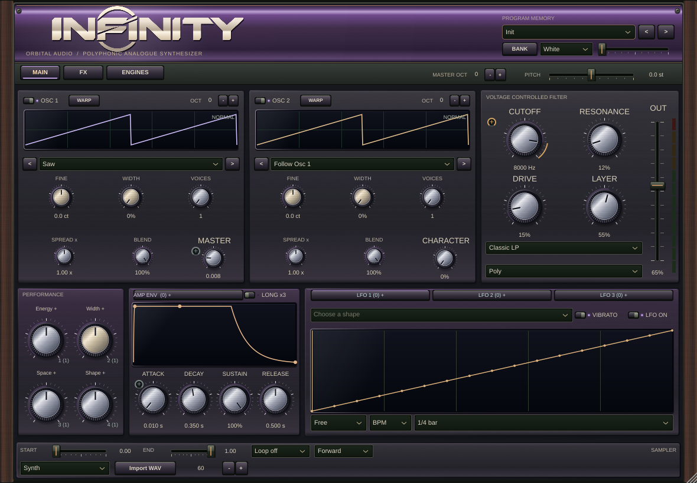
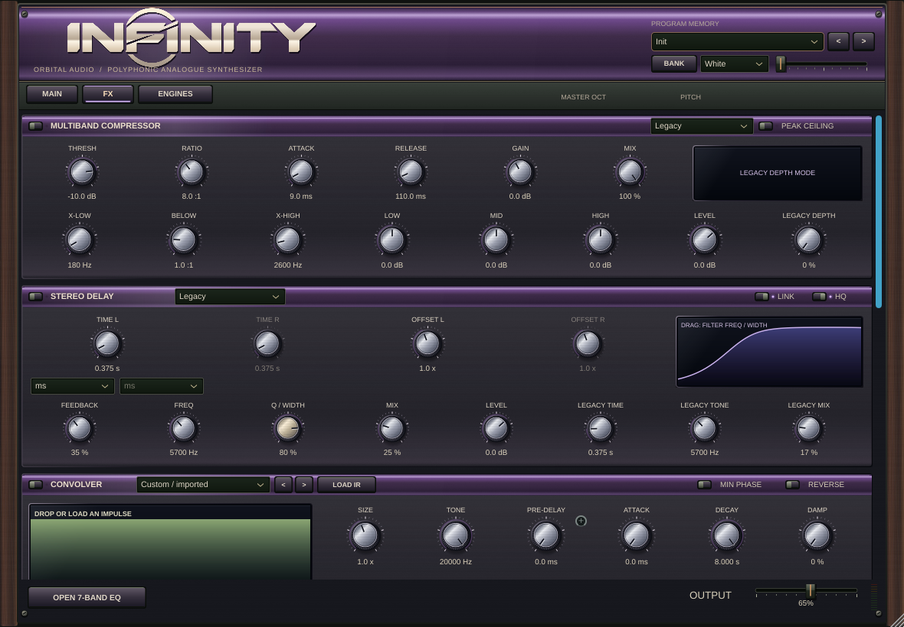

# Save As and material finish

Open **BANK**, give the current sound a name, then choose **SAVE AS...**. The save dialog lets you choose a folder and filename. Files use `.sipreset`; that extension is added automatically. Existing files require overwrite confirmation. A successful save remembers its folder for the lifetime of the plugin instance.

Save As writes a portable snapshot with the sound's settings, imported sample, edited wavetable and impulse response. It does not change the factory bank or the selected browser entry. **SAVE NEW** still adds a sound to the internal user bank; **IMPORT** adds a `.sipreset` saved elsewhere to that browser. User bank files remain intact. Writes use a temporary file so a failed write does not deliberately replace the selected existing sound with partial data.

The visual update uses original procedural artwork: deeply anodised violet with narrow machining reflections, graphite panel recesses, brushed titanium/champagne knob caps, engraved pointers, a foil-finished logo and smoked display glass. Static chassis textures remain cached; material drawing is on the interface thread, without audio-engine processing changes.

Actual native renders:

